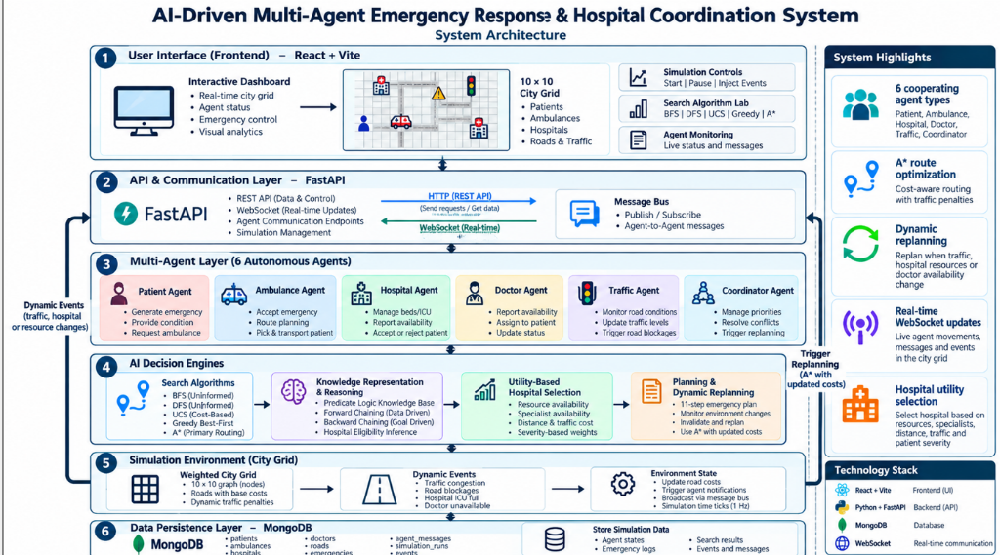

# AI-Driven Multi-Agent Emergency Response System

This project is a comprehensive **Fundamentals of Artificial Intelligence (FOAI)** case study and final-year project. It simulates a smart city where multiple autonomous agents cooperate in real-time to handle emergency medical cases.

Unlike a standard CRUD application, this project is designed from the ground up to explicitly demonstrate core Artificial Intelligence concepts, algorithms, and architectures.

---

## 🎯 Core AI Concepts Demonstrated

### 1. Intelligent Agents & PEAS Framework
The system is built on a Multi-Agent Architecture consisting of 6 distinct autonomous agents:
- `PatientAgent`, `AmbulanceAgent`, `HospitalAgent`, `DoctorAgent`, `TrafficAgent`, `CoordinatorAgent`.
- Each agent has a formally defined **P**erformance measure, **E**nvironment, **A**ctuators, and **S**ensors.

### 2. Search Algorithms (State Space Search)
The city is modeled as a 10×10 grid graph with varied base road weights (simulating arterial avenues vs. residential side streets) and dynamic traffic states. The `SearchEngine` implements 5 distinct algorithms:
- **Uninformed Search**: BFS (Breadth-First Search), DFS (Depth-First Search)
- **Cost-Based Search**: UCS (Uniform Cost Search)
- **Informed Search**: Greedy Best-First Search, A* (A-Star) Search

#### Path Length vs. Path Cost — Key AI Distinction:
| Metric | What It Measures | Optimized By |
|---|---|---|
| **Path Length** | Number of hops/nodes in the route (spatial steps) | **BFS** (guarantees fewest hops) |
| **Path Cost** | Sum of actual edge weights (travel time, congestion, fuel) | **UCS & A\*** (guarantee lowest total cost) |

> **Note**: Path length is **not** identical for every algorithm. While algorithms can coincidentally find paths with the same hop count on an unobstructed open grid (e.g., Manhattan distance from `(0,0)` to `(9,9)` is 18 hops / 19 nodes), in general:
> - **DFS** can take winding, suboptimal detours (e.g. 15+ hops when 13 hops exist).
> - **UCS and A\*** will deliberately choose longer hop routes (higher path length) if taking a detour avoids expensive, congested roads to achieve a lower overall cost.
> - **BFS** strictly minimizes the hop count, even if it forces the ambulance through heavily congested or expensive roads.

#### Algorithm Comparison Matrix:
| Algorithm | Type | Optimal Cost? | Optimal Length (Hops)? | Nodes Expanded | Purpose in Project |
|---|---|:---:|:---:|---|---|
| **BFS** | Uninformed | ❌ No | ✅ Yes | High (~100) | Baseline: finds fewest hops, ignores road costs |
| **DFS** | Uninformed | ❌ No | ❌ No | Low (~19-80) | Educational: demonstrates risk of unguided depth search |
| **UCS** | Cost-Based | ✅ Yes | ❌ No | High (~100) | Cost-optimal: finds cheapest route without heuristic |
| **Greedy** | Informed | ❌ No | ❌ No | Very Low (~13-19) | Fast heuristic: rushes towards goal, ignores edge cost |
| **A\*** | Informed | ✅ Yes | ❌ No | Moderate (~50-85) | **Core Engine**: optimal cost + fast heuristic guidance |

### 3. Knowledge Representation & Reasoning
- **Knowledge Base (KB)**: Stores facts about patients, hospital capacities, specialists, and road conditions using first-order predicate logic.
- **Forward Chaining**: Data-driven reasoning. When new facts arrive (e.g., patient needs ICU), the engine fires rules bottom-up to derive eligibility (`hospital_eligible_for_patient`).
- **Backward Chaining**: Goal-driven reasoning. Proves specific hypotheses like `can_hospital_treat_patient(H1, P001)` by constructing a proof tree backwards from the goal to existing facts.

### 4. Utility-Based Decision Making
- The `DecisionEngine` uses a multi-attribute utility function to rank and select hospitals mathematically:
  $$U = (w_{\text{res}} \times \text{ResourceScore}) + (w_{\text{spec}} \times \text{SpecialistScore}) - (w_{\text{dist}} \times \text{DistanceScore}) - (w_{\text{traffic}} \times \text{TrafficScore})$$
- Weights dynamically adapt based on patient severity (e.g., ICU capacity is weighted heavily for CRITICAL cases, whereas distance is prioritized for LOW severity).

### 5. Planning Under Uncertainty & Dynamic Replanning
- Generates an 11-step `EmergencyPlan`.
- The environment is dynamic and stochastic (traffic incidents, doctor availability changes, road closures).
- When a plan step is invalidated mid-execution, the `CoordinatorAgent` triggers dynamic replanning with A*, keeping completed milestones and rerouting seamlessly.

---

## 🏗️ Architecture



### Backend (Python / FastAPI)
- **FastAPI**: REST endpoints for search, reasoning, and scenarios, plus WebSocket at `/ws/simulation` streaming 1Hz state ticks.
- **Agent Engines**: Clean modular packages for Agents, Search, Knowledge, Reasoning, Decision, and Planning.
- **Message Bus**: Asynchronous Pub/Sub communication channel facilitating loose coupling between agents.
- **MongoDB**: Asynchronous Motor connection logging messages, emergencies, search comparisons, and simulation runs.

### Frontend (React / Vite)
- **Vanilla CSS Design System**: Modern dark-mode, glassmorphism UI with micro-animations and zero external CSS libraries.
- **Interactive Canvas Visualizer**: Live rendering of the city grid, road congestion states, vehicle locations, and active paths.
- **Search Lab**: Side-by-side visual playground comparing BFS, DFS, UCS, Greedy, and A* with canvas overlays and performance metric tables.
- **Knowledge Base Inspector**: Interactive visualizer showing facts and rule firings.

---

## 🚀 Setup & Installation

### Prerequisites
- Node.js (v18+)
- Python (v3.10+)

### 1. Start the Backend
```powershell
cd backend
python -m venv venv

# Windows (PowerShell):
.\venv\Scripts\Activate.ps1

# Mac / Linux:
# source venv/bin/activate

pip install -r requirements.txt
python -m uvicorn main:app --host 0.0.0.0 --port 8000 --reload
```

### 2. Start the Frontend
```bash
cd frontend
npm install
npm run dev -- --host
```

### 3. Run the Application
Open your browser to `http://localhost:5173`.
1. **Search Lab**: Test and compare all 5 pathfinding algorithms between any start and goal coordinates.
2. **Scenarios Tab**: Choose from 7 pre-configured edge cases (e.g., Road Blockage, ICU Full, Doctor Unavailable) and trigger the live run.
3. **Live Simulation**: Watch the 34 agents coordinate, dispatch, navigate, and replan in real-time.
4. **Analytics**: Review response times, throughput, and decision logs.

---

## 📁 Project Structure

```
FOAI_Project/
├── backend/
│   ├── agents/             # Autonomous agent classes (Patient, Ambulance, Hospital, Doctor, Traffic, Coordinator)
│   ├── api/                # FastAPI REST & WebSocket routers
│   ├── communication/      # Async Pub/Sub MessageBus
│   ├── database/           # MongoDB async connection & loggers
│   ├── decision/           # Utility-based multi-criteria scoring
│   ├── knowledge/          # Predicate logic Knowledge Base & rules
│   ├── models/             # Pydantic v2 domain schemas
│   ├── planning/           # 11-step EmergencyPlanner
│   ├── reasoning/          # Forward & Backward chaining inference engines
│   ├── search/             # BFS, DFS, UCS, Greedy, A* implementations
│   ├── simulation/         # 1Hz tick simulator, city grid, and events
│   ├── main.py             # FastAPI entry point
│   └── requirements.txt
├── frontend/
│   ├── src/
│   │   ├── components/     # UI components (CityGrid, Sidebar, SearchCanvas, etc.)
│   │   ├── hooks/          # useSimulation WebSocket state hook
│   │   ├── pages/          # Dashboard, LiveSimulation, SearchLab, KnowledgeBase, Analytics, Scenarios
│   │   ├── services/       # REST and WebSocket API services
│   │   ├── styles/         # Vanilla CSS design tokens & layouts
│   │   ├── App.jsx         # App router & layout shell
│   │   └── main.jsx        # Vite entry point
│   └── package.json
├── test_cases.py           # Standalone verification script for AI core engines
└── README.md
```
